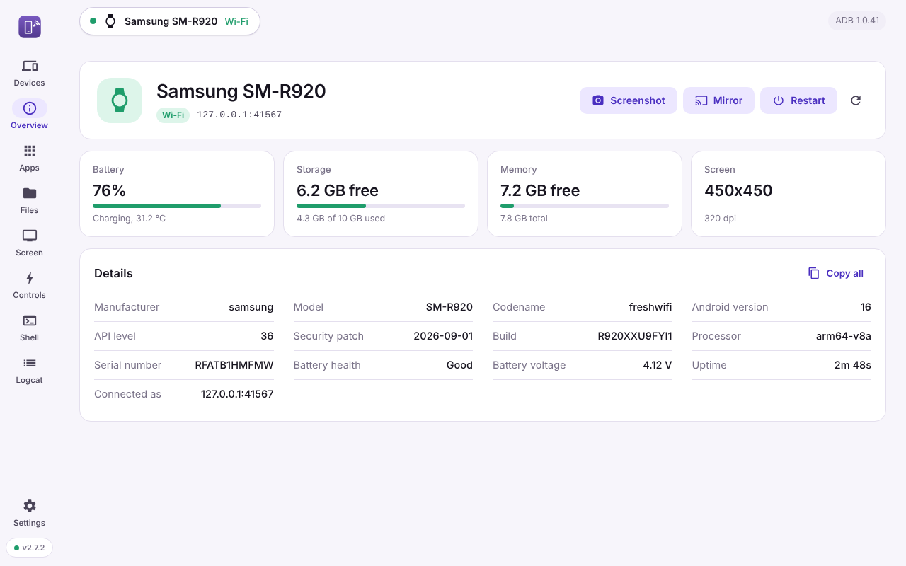
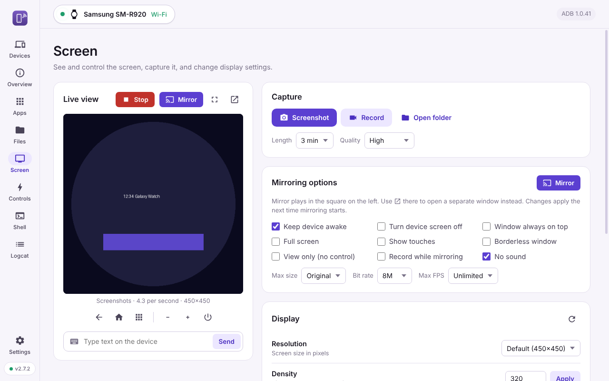
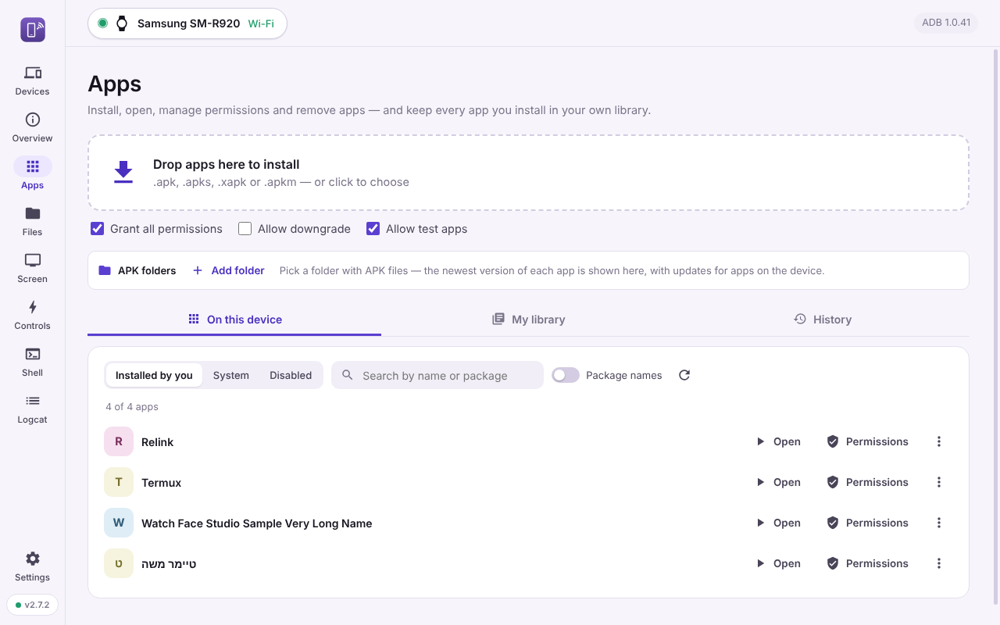

# ADB Connector

A simple Windows app for **any Android device** — phones, tablets and watches (including Galaxy Watch / Wear OS) — over USB or Wi‑Fi, without the command line.

<p align="center"></p>

## Download
Get **ADB-Connector-Setup-x.y.z.exe** from [Releases](https://github.com/angreenade/adb-connector/releases/latest) and run it. It installs in seconds (no admin needed) and **updates itself** — watch the button at the bottom left.

Windows may say "Windows protected your PC" the first time (the app isn't code-signed): click **More info → Run anyway**.

## Features
- **Connect** over USB, Wi‑Fi pairing (code or QR), IP address, LAN scan, or WebUSB — and remembers devices and reconnects automatically
- **Screen**: live mirroring inside the app with touch control, full screen, or a separate scrcpy window; screenshots and screen recording
- **Apps**: install .apk, split APKs, .apks / .xapk / .apkm (with game data), install older versions, real app names and icons, permissions, open / stop / clear / disable / uninstall
- **App library & history**: every app you install or save is kept on your computer, any version, reinstall with one click
- **Files**: browse, upload, download, rename, delete
- **Shell**: a full terminal with history, autocomplete and long-command support
- **Logcat** with filters, and **quick commands** by category (display, power, network, developer and more)
- Several devices at once — switch from the top bar

<p align="center">
  
  
</p>

## Connecting a device
Turn on **Developer options** on the device (tap *Build number* 7 times in *About phone* / *About watch*), then:

| How | Device | Steps |
|---|---|---|
| **USB** | Any Android | Turn on **USB debugging**, plug in, tap **Allow** on the device. Some brands need their Windows USB driver (e.g. Samsung, Google). |
| **Wi‑Fi pairing** | Android 11+ and Wear OS | Turn on **Wireless debugging** → *Pair with code* (or QR), enter the IP, port and code in the app. Computer and device must be on the same Wi‑Fi. |
| **Wi‑Fi from USB** | Android 10 and older | Connect by USB once, press **Switch to Wi‑Fi**, then unplug. |

**Notes**
- Mirroring needs Android 5.0 or newer.
- Xiaomi / Redmi / POCO: also turn on **USB debugging (Security settings)** for touch control and permission granting.
- Built-in system apps can't be deleted from a normal (non-rooted) device. The app can turn them off for your user instead, and you can bring them back at any time.

## Build from source
```
npm install
npm start        # run in development
npm run dist     # build the Windows installer
```
Releases are built by GitHub Actions when the version in `package.json` changes. Includes scrcpy 3.3.1 and adb (`vendor/platform`).

## Privacy
Everything runs on your computer — no account, no analytics. The only internet connection is the update check against GitHub Releases. See [SECURITY.md](SECURITY.md).

What's new in each version: [CHANGELOG.md](CHANGELOG.md).

## License
ADB Connector is free software under the [MIT License](LICENSE).
It includes scrcpy, adb, FFmpeg, SDL2, libusb and other open-source components under their own licenses — see [THIRD_PARTY_NOTICES.md](THIRD_PARTY_NOTICES.md).

Android, Wear OS and Galaxy Watch are trademarks of their respective owners. This is an independent project, not affiliated with or endorsed by Google or Samsung.
